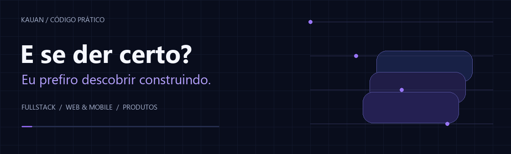
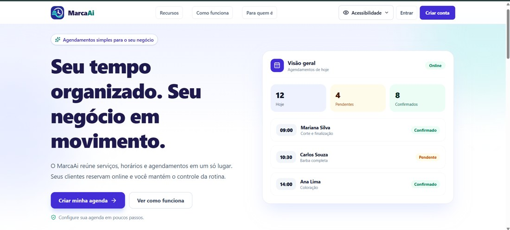
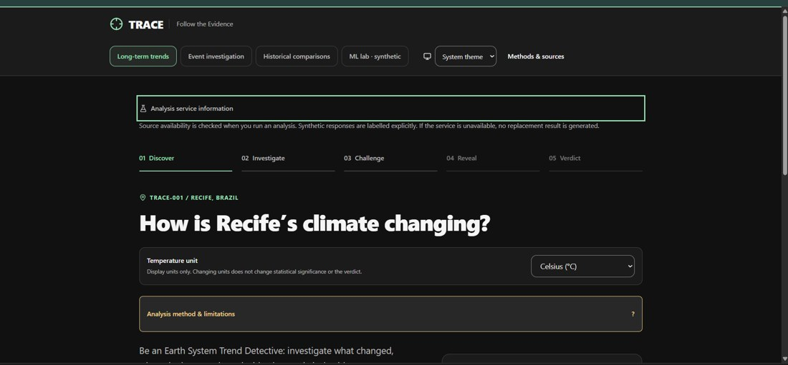
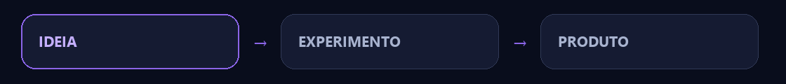

  

**Desenvolvedor Fullstack · Empreendedor · Criador do Código Prático**

Transformo curiosidade em experiências digitais e ideias em produtos.

---

## ✦ Sobre mim

Sou formado em **Informática para Internet pelo IFPE** e curso **Bacharelado em Inteligência Artificial no CIn-UFPE**.

Gosto de conectar programação, matemática e negócios para construir soluções úteis. Minha atuação envolve interfaces web e mobile, integração de APIs, banco de dados, autenticação e organização de produtos.

Sou **sócio da Argus AI**, onde trabalho no desenvolvimento do MarcaAi, na organização do produto e nas atividades comerciais.

## ◇ Projetos em destaque

<table>
<tr>
<td width="50%" valign="top">

### 🗓️ MarcaAi

SaaS de agendamento online e gestão de horários para profissionais e estabelecimentos de serviços.

Atuo no desenvolvimento fullstack, na organização do produto e nas vendas, com a colaboração de outro desenvolvedor no QA.

**React · TypeScript · Supabase · PostgreSQL · Cloudflare**

[**Acessar aplicação ↗**](https://marcaai.online/)

</td>
<td width="50%" valign="top">

### 🌍 TRACE — Follow the Evidence

Aplicação para explorar evidências climáticas históricas de Recife, desenvolvida pela **equipe Marco Zero** no NASA Space Apps Challenge 2026.

Contribuí com a interface, navegação, visualização de dados, responsividade e integração com a API.

**React · Vite · Integração de APIs**

[**Acessar aplicação ↗**](https://victor-tenorio.github.io/trace-follow-the-evidence/)

[**Ver código ↗**](https://github.com/victor-tenorio/trace-follow-the-evidence)

</td>
</tr>
<tr>
<td width="50%" valign="top">

### ⚖️ Exceptios

Aplicação web e mobile em desenvolvimento para centralizar a relação entre advogados e clientes.

Trabalho no desenvolvimento fullstack, incluindo interfaces, integração com banco de dados, autenticação e controle de acesso.

**React · React Native · Expo Router · TypeScript · Supabase**

🚧 Em desenvolvimento · Repositório privado

</td>
<td width="50%" valign="top">

### 🧪 Outros projetos

[**Expense Tracker**](https://github.com/codigopratico/expense-tracker-app)

Aplicativo mobile de controle de despesas com Expo e TypeScript.

---

[**Automação de áudio com IA**](https://github.com/codigopratico/audio-openai)

Experimentos com áudio e APIs da OpenAI em Python.

---

[**DriveMax**](https://codigopratico.github.io/drivemax/)

Landing page responsiva desenvolvida com Vue.js.

</td>
</tr>
</table>

## ⌘ Tecnologias que utilizo

**Web e mobile**

**Dados e infraestrutura**

## ↗ Da ideia ao produto

- **Ideia:** observar problemas e fazer perguntas.
- **Experimento:** testar caminhos, aprender e ajustar.
- **Produto:** transformar o aprendizado em algo que possa ser usado.

---

### Tem uma ideia interessante? Vamos conversar.

[LinkedIn](https://www.linkedin.com/in/codigo-pratico/) · [E-mail](mailto:fandaart.75@gmail.com)

Curiosidade em movimento. Ideias virando produtos.

